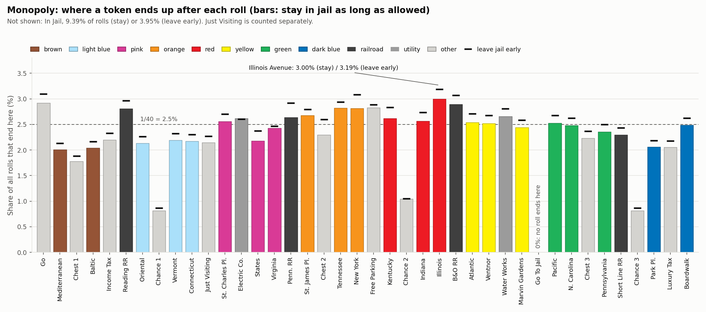
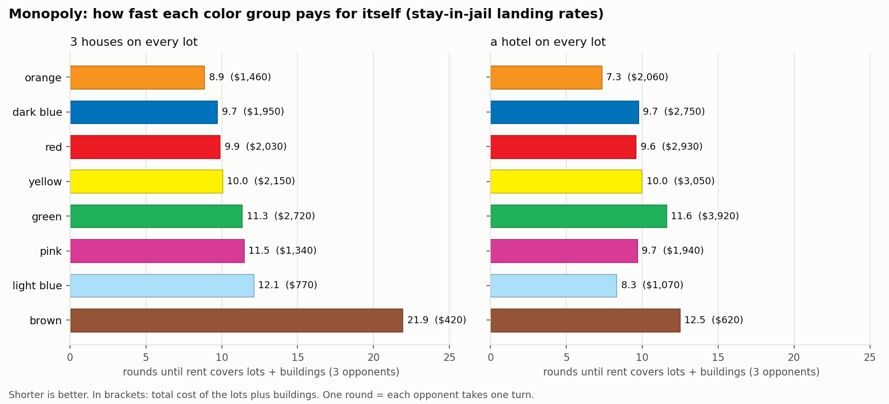
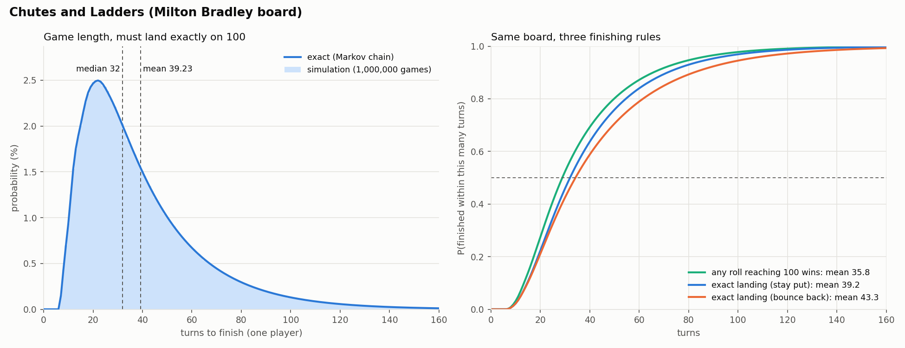

# Board Games as Markov Chains

Exact long-run odds for Monopoly and Chutes and Ladders from linear algebra, checked against a million-token simulation.

## Why

I wanted to know which Monopoly properties are actually worth buying, and how long a game of Chutes and Ladders really lasts. Once you fix the house rules, both games are just dice, so both can be solved exactly instead of argued about at the table.

## Method

### Monopoly

One step is one roll. Position alone can't predict the next roll, because a third double in a row sends you to jail, so each state also records how many doubles you've rolled so far this turn. Jail gets three states of its own, since how you leave depends on which attempt you're on. That's 40 × 3 + 3 = 123 states, and I build the 123 × 123 transition matrix `P` straight from the rulebook (including the spot where Chance's "back 3" card drops you on Community Chest and you draw again).

The stationary distribution satisfies `πP = π`, which makes it the left eigenvector of `P` for eigenvalue 1. I solve `(Pᵀ − I)π = 0` directly, swapping one redundant equation for `sum(π) = 1`. Power iteration and an eigensolver agree with it to within 7e-16. I compare two jail habits: "stay" (roll for doubles for up to three turns) and "leave early" (pay $50 right away).

### Chutes and Ladders

Square 100 is absorbing. With `Q` as the transitions among the other squares, the fundamental matrix `N = (I − Q)⁻¹` holds the expected visits to each square. Its row sums `t` give the expected game length, and `(2N − I)t − t²` gives the variance.

### Checking with simulation

A separate NumPy simulator, written from the rules without touching `P`, moves 1,000,000 independent tokens. Each makes 100 warm-up rolls (the second eigenvalue has modulus 0.872, so the start fades to about 1e-6) and then 20 counted rolls. Rolls from one token are correlated. A binomial interval would be wrong here, and so would a chi-square on all 20 million rolls. I treat each token as one independent sample instead. Confidence intervals come from the spread of per-token frequencies, the chi-square uses each token's final position, and Hotelling's T² tests all 39 free categories at once with every counted roll.

## Results

### Where tokens end up (% of all rolls)

| # | Stay in jail | % | Leave early | % |
|--:|---|--:|---|--:|
| 1 | Illinois Avenue | 2.9955 | Illinois Avenue | 3.1858 |
| 2 | Go | 2.9183 | Go | 3.0961 |
| 3 | B&O Railroad | 2.8928 | New York Avenue | 3.0852 |
| 4 | Free Parking | 2.8248 | B&O Railroad | 3.0659 |
| 5 | Tennessee Avenue | 2.8197 | Reading Railroad | 2.9631 |
| | In Jail | 9.3855 | In Jail | 3.9500 |

Staying in jail pulls 5.4 points of rolls into jail, and every square you can stop on loses share except Electric Company (2.604% to 2.615%). It sits two squares past jail, and snake eyes is 1 of the 6 rolls that let you out. My leave-early column matches Truman Collins' published table to within 0.0001 points on all 41 categories. His long-jail column only matches if doubles out of jail earn another roll. The official rules say they don't, so I kept the rulebook version.



### Is building worth it?

I own a full color group and build evenly. Three opponents land on it at the stay-in-jail rates, and one round is three opponent turns.

| Group | 3 houses: total cost | Rounds to pay back | Hotels: total cost | Rounds to pay back |
|---|--:|--:|--:|--:|
| orange | $1,460 | 8.9 | $2,060 | 7.3 |
| dark blue | $1,950 | 9.7 | $2,750 | 9.7 |
| red | $2,030 | 9.9 | $2,930 | 9.6 |
| yellow | $2,150 | 10.0 | $3,050 | 10.0 |
| green | $2,720 | 11.3 | $3,920 | 11.6 |
| pink | $1,340 | 11.5 | $1,940 | 9.7 |
| light blue | $770 | 12.1 | $1,070 | 8.3 |
| brown | $420 | 21.9 | $620 | 12.5 |

Orange wins at both levels. Light blue jumps from seventh to second with hotels, since its houses cost $50. The third house is the fastest-paying step in 7 of 8 groups (brown's is the hotel). For orange it costs $300, adds $104.68 a round and pays for itself in 2.9 rounds. With leave-early rates the order stays the same and every payback is 6.5% to 8.2% shorter.



### Simulation vs. exact

| Policy | Max abs. error | Exact inside 95% CI | Chi-square (df 39), p | Hotelling T² (df 39), p |
|---|---|--:|--:|--:|
| stay | 1.24e-4 (In Jail) | 37 of 40 | 34.24, 0.687 | 48.96, 0.132 |
| leave early | 1.16e-4 (Community Chest 1) | 37 of 40 | 45.43, 0.222 | 58.90, 0.021 |

That 0.021 bugged me. Community Chest 1 came out 4.0 standard errors low in that run, which should happen about once in 400. `scripts/seed_check.py` reruns it with seeds 1 to 4, and the z-scores come back as 0.40, 1.43, -0.21 and -0.19 (T² p-values 0.60, 0.82, 0.97, 0.46). A fluke, so I kept the original seed.

### Chutes and Ladders

This is the Milton Bradley board with one die. You have to land exactly on 100; a roll that overshoots means you stay put.

| One player | Exact | Simulated (1M games) |
|---|--:|--:|
| Expected turns | 39.2251 | 39.2217 (95% CI 39.172 to 39.271) |
| Variance | 636.30 | 635.11 |
| Median / 90th percentile | 32 / 72 | |
| Shortest game | 7 turns (0.151%) | 7 |
| Longer than 100 turns | 3.10% | |

That's the 39.2 Althoen, King and Schilling published in the Mathematical Gazette in 1993. I'd also seen 39.6 quoted. It turns out some boards start the 47 → 26 chute on square 48 instead, and that layout gives 39.598. If any roll reaching 100 wins, the mean drops to 35.83 turns. With two players, whoever goes first wins 50.79% of the time. The exact median sits right on the edge (P(T ≤ 32) = 0.50005), so I don't count the simulated median as a check.



## Reproduce

```bash
pip install -r requirements.txt
python scripts/run_all.py      # every number and figure here, about 10 s
pytest                         # 37 tests
```

Seeds are fixed, so `results/` and `figures/` should come out identical to mine.

## Assumptions and limitations

Cards are drawn with replacement from a full deck. Real decks are dealt in order, and tracking that would blow the state space far past a dense matrix. Get Out of Jail Free cards count as cards that don't move you. The payback numbers leave out mortgages and trading. They also assume opponents always have the cash, so read them as a way to compare groups and not as a forecast.

MIT license.
